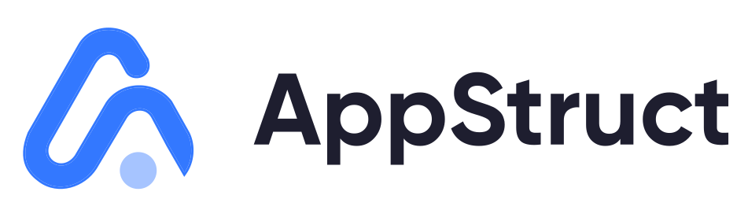

# AppStruct nodes for n8n



Connect [AppStruct App Builder](https://appstruct.ai/app-builder?utm_source=github&utm_medium=referral&utm_campaign=n8n_quickstart_20261113&utm_content=readme_product) projects, tables and records to an n8n workflow. AppStruct combines visual app building with a separate collaborative workspace for documents, spreadsheets and presentations.

This community package works with **App Builder projects and tables**. Docs, Sheets and Slides use separate [MCP integrations](https://appstruct.ai/integrations/mcp?utm_source=github&utm_medium=referral&utm_campaign=n8n_quickstart_20261113&utm_content=readme_mcp); their product API keys are not the credentials for this node.

## Version and compatibility

This source targets **2.0.0**. Check the [npm versions](https://www.npmjs.com/package/n8n-nodes-appstruct?activeTab=versions) before installing: a merged GitHub change does not update the published npm package. If 2.0.0 is not published yet, build and test the candidate locally using [TESTING.md](TESTING.md).

2.x requires **n8n 2.47.7 or newer with Node.js 24+**. It is tested with n8n 2.47.7 and n8n-workflow 2.16.0. Older n8n hosts are not supported by this release. The package keeps its existing node type IDs, version-1 workflow definitions and `appStructApi` email/password credential fields.

## Start here: list your projects

Use [the manual first-read workflow](https://appstruct.ai/downloads/appstruct-n8n-list-projects.json) to check the connection before configuring writes or a scheduled automation.

```text
Manual trigger → AppStruct: Project / Get Many → inspect IDs and project names
```

1. Install the published `n8n-nodes-appstruct@2.0.0` release on a compatible self-hosted n8n instance that allows community packages. Follow [n8n's installation instructions](https://docs.n8n.io/integrations/community-nodes/installation/) for your deployment.
2. Download `examples/list-projects-read-only.json`, then import it using the n8n editor's **Import from File** option. See [n8n's import/export guide](https://docs.n8n.io/workflows/export-import/).
3. Open the **List AppStruct projects** node and select an **AppStruct API** credential. The package uses your AppStruct account email and password, stored in n8n credentials, to obtain an access token. n8n manages the token through `preAuthentication`; the login uses AppStruct’s explicit JSON-client protocol and does not use browser cookies.
4. Execute the manual workflow. Compare the returned `id` and `projectName` values with your AppStruct Apps library. An empty library can produce an empty result; create a separate practice project and repeat the check if needed.

The starter is inactive and contains no credentials, pinned account data, automatic triggers or third-party destination nodes. It selects a read operation; the account credential itself is **not** restricted to reads. Use an n8n instance you trust, inspect every operation you add, and remove credential references and execution data before sharing an export.

For the full walkthrough and troubleshooting, see the [AppStruct n8n setup guide](https://appstruct.ai/integrations/n8n?utm_source=github&utm_medium=referral&utm_campaign=n8n_quickstart_20261113&utm_content=readme_guide).

## Installation and hosting

Package name: `n8n-nodes-appstruct`. The 2.x release uses the current official n8n build and validation tools and has no runtime npm dependencies.

The npm installation path is for self-hosted n8n. n8n Cloud supports verified community nodes; this repository does not establish AppStruct as a verified Cloud node or promise availability there. Check the [current n8n community-node requirements](https://docs.n8n.io/integrations/community-nodes/installation/) before choosing a deployment.

## Supported operations

| Resource | Operations |
| --- | --- |
| Projects | Get Many |
| Tables | Get Many, Create, Get Schema, Delete |
| Records | Get Many, Create, Update, Delete |
| Columns | Add |

For operations on tables or records, select the actual project and table from your account. The first-read example intentionally does not hard-code either. Authentication and project-list behavior are implemented in [AppStruct.node.ts](nodes/AppStruct/AppStruct.node.ts).

## Polling behavior in 2.x

Use n8n's **Poll Times** control to set the schedule. The previous custom Poll Interval field did not control n8n's scheduler and has been removed.

- On the first automatic poll, the node records a baseline without emitting historical data.
- New Row emits newly observed IDs once. Updated Row emits changed data for an existing ID, including nested-field changes.
- New Table and New Column emit additions instead of repeating the entire list.
- Manual tests preview the current items without moving the automatic polling baseline.
- Changing the monitored project, table or event starts a fresh baseline.
- Event timestamps come from the saved source fields; the node does not invent creation times for items without them.
- Record polling requires stable nonempty IDs. It observes the full returned table and stops with an error if the Record Poll Limit is reached, rather than silently monitoring a truncated result. The default is 1,000 records; the maximum is 10,000.
- n8n's workflow static data stores IDs and SHA-256 digests, not copies of the record contents. Normal n8n execution history can still contain returned records.

Polling sees state at each successful run. It cannot report an item created and deleted between polls or every intermediate edit. Review this behavior before upgrading an active 1.x workflow.

## Build one useful workflow

For a service-request workflow, first define the form, stored fields and status update in AppStruct. The [service-request app tutorial](https://appstruct.ai/guides/build-service-request-app?utm_source=github&utm_medium=referral&utm_campaign=n8n_quickstart_20261113&utm_content=readme_tutorial) uses an educational example to plan these steps.

Then read a small set of fictional requests from the selected table in n8n. Before connecting notifications, decide which records qualify, what information to send and how repeated runs avoid duplicate messages. Test the destination and failure behavior separately before enabling a schedule.

The older [basic workflow](examples/basic-workflow.json) is a different example: it polls, creates log records and includes a placeholder Slack webhook. Configure and review those operations before running it; use the manual project-list starter for your first connection check.

## Troubleshooting

- **Unknown node after import:** confirm the community package is installed and available in the same n8n instance. Follow your administrator's restart requirements.
- **Authentication fails:** check the chosen AppStruct credential and the account's email/password sign-in. This package does not take a Docs, Sheets or Slides API key.
- **No projects returned:** check the account and Apps library. Importing the workflow is not proof of a working authenticated connection.
- **A later write fails:** verify the actual selected project, table schema, operation and mapped fields in a practice workflow before retrying.

## Resources

- [AppStruct n8n guide](https://appstruct.ai/integrations/n8n?utm_source=github&utm_medium=referral&utm_campaign=n8n_quickstart_20261113&utm_content=readme_resources)
- [AppStruct App Builder](https://appstruct.ai/app-builder?utm_source=github&utm_medium=referral&utm_campaign=n8n_quickstart_20261113&utm_content=readme_resources)
- [n8n community-node documentation](https://docs.n8n.io/integrations/community-nodes/)
- [Source repository](https://github.com/AppStructAI/n8n-nodes-appstruct)

## License and support

MIT. See [LICENSE.md](LICENSE.md).

Contact [support@appstruct.cloud](mailto:support@appstruct.cloud) for support. Include your package and n8n versions and the failing operation; do not send passwords, tokens or private workflow exports.
